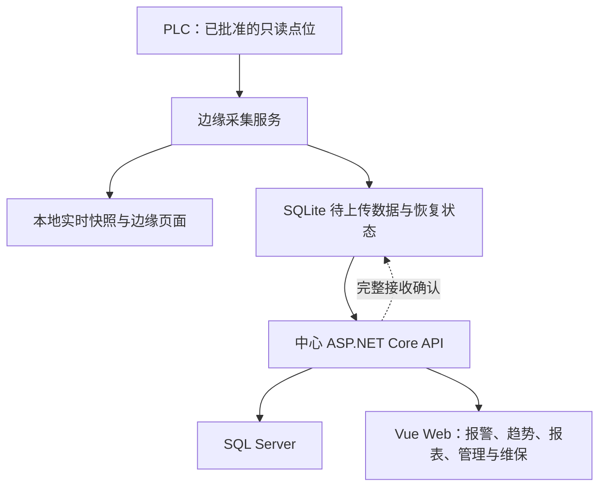

# 系统与工程架构地图

[首页](README.md) · [知识库](docs/README.md)

这张地图给出两类关系：SCADA 的运行时数据流，以及 AI 辅助开发的知识、工具与验收流。建议分别设计它们，再通过明确的任务和验证契约连接。

## 运行组件

图表示主要的数据传递关系。Web 的查询由 API 访问数据库，浏览器不直接连数据库。边缘实时查看和中心历史查询是不同路径，周期采集不等于周期全量上传。

| 建议组件 | 责任 | 不承担 |
| --- | --- | --- |
| 采集服务 | 只读协议、周期调度、变化检测、缓存、补传、心跳 | PLC 控制、中心数据库访问 |
| 中心服务 | 接收、生命周期、查询、权限、部署任务和维保业务 | PLC 协议读取 |
| Web | 信息架构、表单、查询状态、交互、图表与导出 | 绕过 API 的持久化和远程命令 |
| 数据库迁移 | 结构演进、唯一约束、索引、查询函数版本 | 自动覆盖后续业务口径 |
| 工程工具 | 本机验证、隔离仿真、受控发布与诊断 | 把普通开发授权扩大到生产 |

## 工程依赖方向

建议由产品规格定义目标，设计文档定义状态、接口与不变量，工程规则说明如何实现、验证和交付，运维文件定义操作契约。实施过程中，用执行计划推进任务，用结果记录保存证据，用当前交接维护仍有效的事实。

实施时，建议让模块目录、命令入口和测试设计遵循这些契约，并检查依赖方向是否可见、可验证。

## 应如何深入

- 数据可靠性：[采集](docs/design-docs/09-协议适配与采集服务详细设计.md) → [持久化与补传](docs/design-docs/10-实时数据与历史数据详细设计.md) → [报警](docs/design-docs/11-报警事件详细设计.md)。
- 全栈业务：[权限](docs/design-docs/16-Web登录与权限设计.md) → [操作记录](docs/design-docs/18-Web操作记录设计.md) → [维保](docs/design-docs/19-设备维保无纸化.md)。
- AI 工程：[Harness](docs/engineering/HARNESS.md) → [工作流](docs/engineering/AI-WORKFLOW.md) → [质量门禁](docs/engineering/QUALITY.md)。
