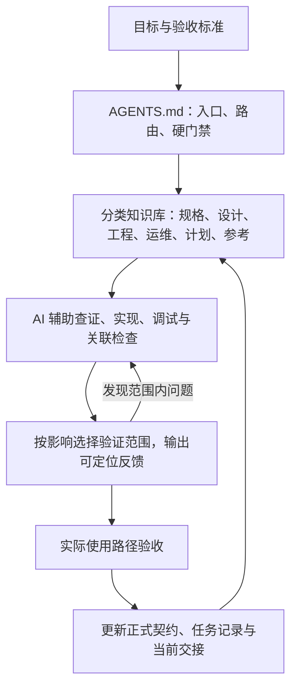

# SCADA × Harness Engineering

**一份面向 AI 辅助开发的工业软件参考方案：从需求规划、系统架构，到工程约束、验证与交付。**

A documentation-first reference design for SCADA and AI-assisted software engineering.

如果要组织 AI 开发一套 SCADA / 设备管理系统，我会怎样拆解需求、划分组件、管理上下文，并判断交付是否可靠？本仓库围绕这个问题，给出我的设计建议、取舍依据和实施路线。

我希望展示的不只是技术选型，还包括把需求、数据、前后端、异常恢复和验收组织成完整方案的能力，以及如何将 Harness Engineering 用于约束和支持 AI 开发。内容以 Markdown 和架构图呈现，供技术交流、方案评审和学习参考。

## 建议从这里开始

| 想了解什么 | 阅读入口 |
| --- | --- |
| 这份方案体现什么规划与综合能力？ | [设计能力与阅读路线](docs/portfolio/项目能力与阅读路线.md) |
| 如何把 Harness Engineering 落到开发流程？ | [Harness 架构](docs/engineering/HARNESS.md) |
| 各模块应该怎样设计？ | [系统架构](ARCHITECTURE.md) · [详细设计](docs/design-docs/index.md) |
| 遇到复杂问题该怎样分析和验证？ | [问题推演](docs/exec-plans/examples/index.md) |

## 我建议的系统边界

边缘节点只读采集设备数据，用 SQLite 保存待上传记录；中心 API 与 SQL Server 负责可靠接收、报警生命周期和业务查询；Vue Web 承载趋势、报表、配置、权限及设备维保。组件通过明确的数据契约协作。

| 领域 | 重点设计问题 | 阅读入口 |
| --- | --- | --- |
| 边缘采集 | 周期调度、批量读取、故障组隔离、异常样本与停止 | [采集设计](docs/design-docs/09-协议适配与采集服务详细设计.md) |
| 缓存与补传 | 事务落盘、完整确认、幂等重传、容量保护 | [数据可靠性](docs/design-docs/10-实时数据与历史数据详细设计.md) |
| 报警与报表 | 入箱与生命周期分离、区间归并、动态分类 | [报警](docs/design-docs/11-报警事件详细设计.md) · [报表](docs/design-docs/14-报表分析详细设计.md) |
| Web 与权限 | 查询状态、迟到响应、分页、导出、服务器鉴权 | [Web](docs/design-docs/13-Web前端页面详细设计.md) · [权限](docs/design-docs/16-Web登录与权限设计.md) |
| 版本管理 | 独立版本目录、操作意图、心跳验收、结果未知恢复 | [发布与恢复](docs/design-docs/15-Web网关配置版本与自动回退设计.md) |
| 设备维保 | 标准快照、任务状态、组织权限、并发、照片与签名 | [维保设计](docs/design-docs/19-设备维保无纸化.md) |

参考技术组合为 C# / .NET、ASP.NET Core、SQL Server、SQLite、Vue 3、Vite、ECharts、PowerShell 与 GitHub Actions。选择服务于这里的约束；规模、团队或环境变化时，应重新评估。

## Harness Engineering 应怎样应用

我的思路是把代理需要的目标、知识、边界和反馈放进仓库，让每次任务都有清晰入口，让偏离能够被发现，让后续任务能够接手。



具体机制包括：简短的代理入口、单一事实来源、脚本调用允许集、分范围验证、检查器负向回归、CI 失败回退和交接替换。各机制的建议实现及局限见 [Harness 设计](docs/engineering/HARNESS.md)。

## 知识库组织

```text
AGENTS.md                 本文档仓库的维护规则
ARCHITECTURE.md            系统组件与工程协作关系
docs/
├── product-specs/        需求、角色、关键选择与实施阶段
├── design-docs/          采集、存储、报警、Web、权限、维保
├── engineering/          Harness、上下文、AI 工作流、安全、质量
├── operations/           发布、恢复、试运行与交接方法
├── exec-plans/           任务规划、问题推演与风险管理
├── references/           接口示例、字段字典与选型依据
└── portfolio/            设计能力、讲述路线与评审清单
templates/                可复用任务、决策、交接和验证模板
```

[知识库导航](docs/README.md) 按六类工程问题组织内容；`portfolio` 提供快速评审与求职展示入口。文档编号用于定位主题，阅读时按任务选择材料。

## 四个值得推演的问题

- [检查器本身如何避免漏检](docs/exec-plans/examples/harness-regressions.md)：语法变体、目录覆盖、Unicode 路径与验证范围。
- [报警统计为什么会算错](docs/exec-plans/examples/alarm-rules-migration.md)：先过滤再归并、嵌套区间、迁移重入。
- [网关操作结果未知时怎么办](docs/exec-plans/examples/gateway-recovery.md)：可观察状态、持久化意图和幂等恢复。
- [维保如何形成完整业务流程](docs/exec-plans/examples/care-workflow.md)：版本、权限、并发、弱网与确认责任。

这四篇按“问题场景 → 设计建议 → 验证方式”展开，可以用来评审方案，也可以作为 AI 开发任务拆解的示例。

## 如何使用

本仓库是一份设计与方法作品集，交付物为文档和内嵌图表。使用者可根据自己的约束调整方案，再按 [评审与验证清单](docs/portfolio/方案评审与验证清单.md) 分阶段验证。阅读说明见 [方案定位](docs/方案定位与使用.md)，展示材料见 [简历与面试展开](docs/portfolio/简历表述与面试展开.md)。

文档采用 [CC BY 4.0](LICENSE.md)。欢迎按 [贡献指南](CONTRIBUTING.md) 补充反例与设计讨论；可复用材料见 [模板目录](templates/README.md)。
