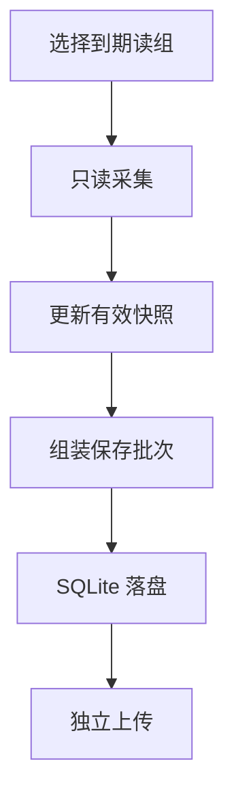

# 协议适配与采集服务详细设计

[设计索引](index.md)

## 运行职责与分组

采集服务加载经过校验的点集，按周期和协议地址组织读取。BOOL 数组与标量采用不同的读取路径；点位配置顺序不决定读取语义。相同数组基址但不同采集周期不能合并，下标按数值排序。

协议支持时，可比较数组批量解码与标量打包读取的收益。建议遵守三个约束：缓冲区必须覆盖所需下标；不足时报告组失败而不构造假值；连接资源按读取器生命周期复用并在断开时释放。

## 周期调度

调度以单调时钟的绝对 deadline 为基准。每轮完成后，从原定时间表推导下一轮；如果已跨过多个 deadline，就跳过过期轮次并对齐未来时间，不排队补发“错过的扫描”。多个周期同时到期时优先处理更短周期。

这一点解决的是累计漂移与堆积问题，不保证协议读取永远小于周期。诊断需要同时显示实际扫描间隔、相对 deadline 的滞后和跳过次数。重连后重新建立调度基准，不沿用断线期间的旧 deadline。

## 正常采集路径

读取结果先判断有效性，再更新快照与变化状态；该轮批次通过 SQLite 事务落盘，由独立循环上传。采集时间表示读取响应所对应的观测时间，不能为了显示准时而改成计划 deadline 或上传时间。对外快照按独立节奏发布，不能把快照刷新当作实际高频采集。

## 异常与缺测

| 失败 | 处理契约 | 不允许的捷径 |
| --- | --- | --- |
| 某读组失败 | 隔离并按约定间隔试读，其他组继续 | 把所有点置零或制造恢复事件 |
| 非有限数值 | 跳过该次样本，保留上次有效值与时间 | 用零代替 NaN 或无穷 |
| 模式点缺测 | 新报警模式记为未知，直到恢复有效读取 | 把过期模式说成本轮已确认 |
| 日志写入失败 | 尽力记录，不拖垮关键采集与落盘 | 将辅助日志错误变成有效数据丢失 |
| 缓存不可写或保护水位触发 | 暂停新扫描，保留已完成批次，暴露状态 | 强杀、截断正在完成的扫描或删除待上传数据 |

故障组首次失败与试读仍可能等待底层超时，因此不能据“已隔离”声称其他组完全没有调度影响。

## 停止与恢复

停止请求先停止调度新轮次，协作结束当前扫描，再把已完成的内存批次写入 SQLite。服务进入 `Stopped` 才能作为替换程序或重启的屏障。缓存已落盘但中心尚未接收，不阻止正常停机。

内存和磁盘保护分别维护：扫描前预留整轮容量，无法落盘时暂停新采集并重试；恢复后重新对齐调度，不补造暂停期间的数据。采集暂停使用明确故障状态，不能通过正常采集验收。

## 必要回归

组故障与恢复、乱序点表、数组边界、非有限值、周期超时、重连后 deadline、停机落盘顺序、磁盘保护与后台异常均需要对应证据。只读扫描的现场性能和对既有通讯的影响，需要当次授权的实机检查。
