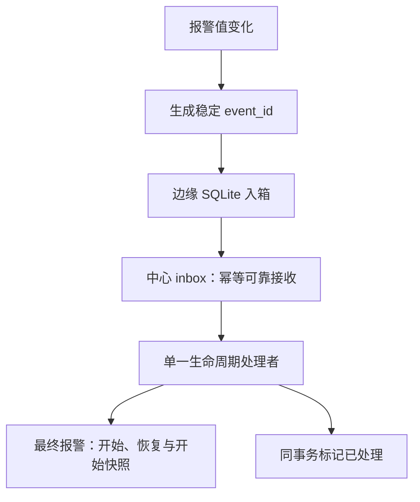

# 报警事件与生命周期设计

[设计索引](index.md) · [接口样例](../references/中心接口样例.md)

## 三种状态分别维护

边缘保存最近真实观测与待上传事件；中心 inbox 保存已可靠接收但可能未处理的原始事件；最终 alarm_events 保存用户查询的生命周期。HTTP 接收成功只证明入箱，不证明生命周期已经处理完成。

## 边缘变化识别

| 上次有效观测 | 新观测 | 语义 |
| --- | --- | --- |
| false | true | 创建 active 原始事件 |
| true | false | 创建 recovered 原始事件 |
| 相同 | 相同 | 不重复生成跃迁 |
| 任意 | 读取失败 | 不改变业务状态，不制造事件 |

首次观测与重启恢复必须结合已保存的报警检查点和中心状态核对，不能简单把“进程刚启动”当成报警刚发生。缺测期间真实变化时刻无法从恢复时的观测倒推。

每个原始事件第一次生成时创建稳定标识，重试、重启和补传不能改号。模式与描述在事件发生时形成快照；恢复不能覆盖开始时的业务快照。模式点失效时使用未知，不阻断其他报警处理。

## 中心处理

接收接口验证批次并集合写入 inbox，唯一约束处理重复与并发。单一后台处理者按设备、地址、事件时间与入箱顺序处理待办。

| 事件与现状 | 结果 |
| --- | --- |
| active，当前无活动生命周期 | 新建生命周期 |
| active，已有活动生命周期 | 不重复新建 |
| recovered，存在活动生命周期 | 闭合原生命周期 |
| 重复或孤立 recovered | 不制造新生命周期，仍标记处理 |

最终表修改和处理标记在同一事务内完成。事务失败时一起回滚，下一轮继续待处理事件；不能先标已处理再更新最终结果。

## 故障统计是另一层解释

原始报警是否计入故障，以点表当前分类为准。时长阈值决定哪些完整生命周期进入统计，保养区间再影响统计时长。这些规则不删除原始报警，不改边缘采集，不等同于信号防抖。

## 验收重点

相同 event_id 的重复与并发接收、回复丢失后重试、两轮完整开始恢复、处理事务中断、中心重启、缺测与模式未知都应有回归。监控分别显示网关待上传、中心待处理与最老等待，不能只看最终活动报警数量判断整条链路健康。
