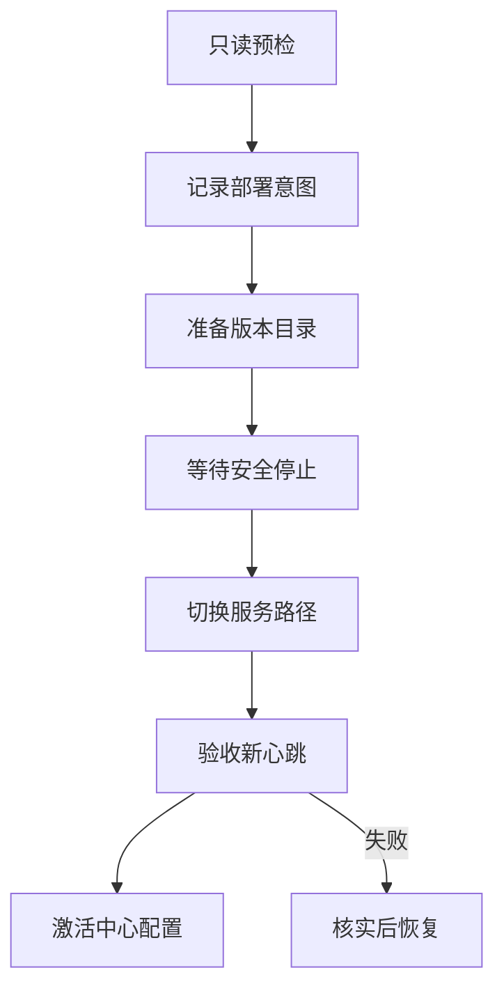

# 网关配置版本与恢复设计

[设计索引](index.md) · [恢复问题推演](../exec-plans/examples/gateway-recovery.md)

## 从文件替换到版本状态

反复搬动活动程序、配置与恢复目录，容易在多步失败中留下难以解释的中间状态。建议使用独立版本目录，保留旧版本原位，通过服务启动路径切换激活候选。

程序版本与配置版本独立。只更新程序不应改写点位业务；只更新配置也不能悄悄替换成未经选择的程序。中心保留当前、上一版和待部署配置，以及最近未解决任务。

## 一次正常任务

预检覆盖完整点集与候选，待部署版本和操作意图需持久化。切换前确认服务进入 Stopped，切换后读回路径，再启动并验收版本匹配的新心跳，最后通过事务激活中心配置。

图简化了异常分支。中心事务结果未知时不能直接跳到恢复，必须先查询是否已激活，防止远端回退而中心实际上已经提交新版本。

## 为什么要先保存意图

远程命令和中心数据库不能组成同一个本地事务。响应丢失后，客户端无法仅凭错误知道命令是否执行。因此关键动作前先记意图，动作后读回实际路径、文件和配置，再推进状态。

重复恢复先判断旧路径是否已经恢复，不反复切换到更旧版本。无法确认时保留待核实状态和证据，不循环重放命令来碰运气。

## 心跳验收

新心跳必须晚于任务前的中心修订号基线，配置版本和应核对的程序标识一致，且状态为有效采集的 running。旧版本心跳、starting、采集错误和缓存错误不能证明新部署成功。

使用修订号避免依赖网关时钟与中心时钟精确一致。恢复旧版的验收需要兼顾旧协议能力，但不能放宽新版成功条件。

## 服务状态屏障

START_PENDING 与 STOP_PENDING 不是稳定结果。等待过渡状态后再决定是否发起启动或停止；没有确认 Stopped 就不能切换路径或重启。超时、服务消失或查询失败保持待恢复状态，不能强杀进程。

## 中心重启与审计

任务意图持久化，中心重启后仍能显示原始失败、已核实步骤与恢复入口。一次性凭据不持久化；需要重新连接时重新取得相应输入，不把密码写入任务日志。配置差异是提交意图，只有最终验收才能证明生效。

## 验收矩阵

上传失败、停止未完成、路径读回不匹配、新程序启动失败、旧心跳迟到、数据库提交响应丢失、中心中断、旧版本已经恢复、首次部署没有旧服务，都有不同期望结果。必须覆盖失败链路，而不仅是一次成功更新。
