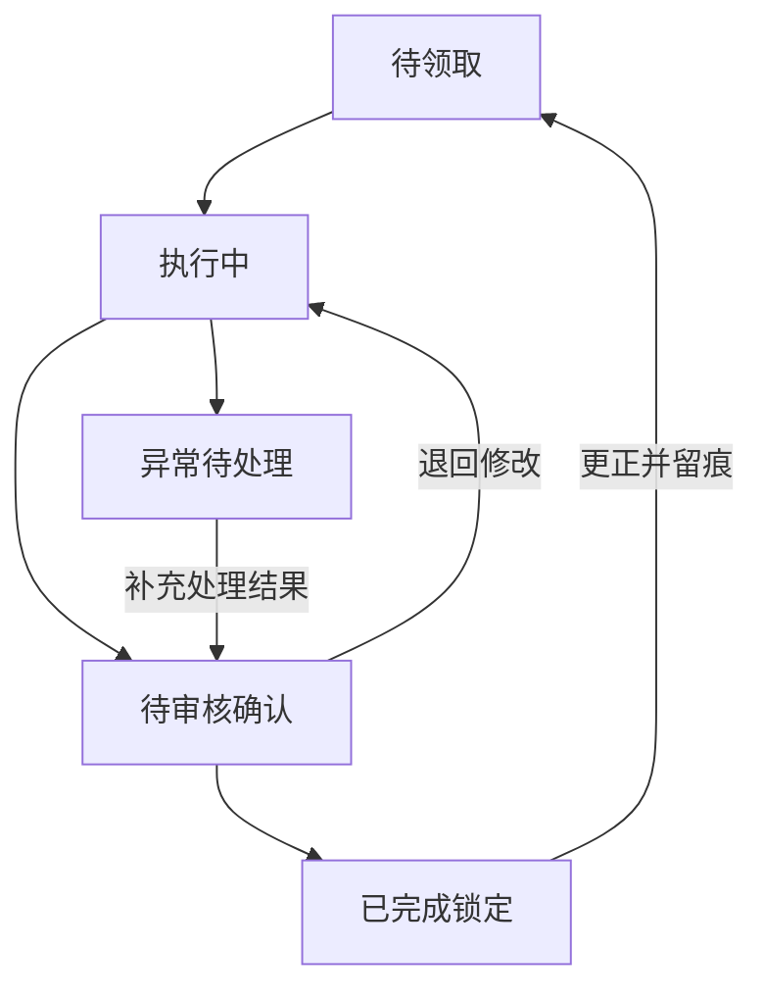

# 设备维保无纸化

[设计索引](index.md) · [业务流程推演](../exec-plans/examples/care-workflow.md)

建议将巡检与保养设计为可追溯流程，以执行人员、审核人员区分业务责任，并围绕标准、任务、版本和确认建立状态契约。

## 标准、计划与任务

标准版本定义检查项目；设备计划定义使用哪个标准与执行周期；任务在生成时保存标准和组织快照。修改标准或计划不能改写已生成任务。

后台使用游标和唯一键分批补生成到期任务，重启继续，不重复发单。首次启用从当前期间开始，停用保留已有待办，重启用不自动追补停用期间。设备离线不能被自动解释为未生产。

## 业务状态流

图中待处理分支包含异常与未完成项，需要补充处理方法和结果；退回必须说明原因，更正必须给出理由并保留旧修订。每次命令还需验证角色、所属组织、领取人和版本。曾参与执行的人也不能确认自己的记录，管理员身份不能绕过业务签名规则。

## 权限与组织变化

组织授权使用完整工厂、线别、阶段路径形成稳定身份，避免同名阶段跨线授权。阶段权限实时展开到下属工序，撤销后列表、详情、照片、导出与操作共同失效。

设备归属变化不修改历史任务。计划显示警告并暂停补生成，重新绑定需要满足原、新范围的业务权限。

## 并发与幂等

任务写入携带版本，命令携带 requestId。同标识同内容重试应返回同一业务结果，同标识不同内容拒绝；版本过期返回冲突，不能自动覆盖。

事务和维保领域锁保护领取、提交、确认与计划生成，不用锁住采集表来解决业务竞争。请求回复丢失时沿原请求标识核实，不能生成新命令假装第一次提交。

## 表单与照片

巡检区分正常、异常、未生产；保养区分正常、异常、未完成。异常备注不能为空，实测值、处理结果和未生产原因按契约要求填写。不能用后来选择正常覆盖异常首次描述。

每次修订有自己的现场拍摄要求，旧修订照片保留查看但不能满足新修订提交条件。服务端拍摄会话绑定账号、任务、修订与项目，校验有效期、格式、大小、数量与单次消费。照片通过授权接口读取，不暴露公共静态目录。

浏览器拍摄会话可以提供流程约束，不能硬件证明图片来源。若业务要求抵抗虚拟摄像头或刻意伪造请求，需要另行评估受控终端与采集设备。

## 手机与弱网体验

手机采用纵向项目卡片，本机草稿按账号和任务隔离。断网允许保留草稿，但不正式提交或确认；恢复后先处理版本冲突。拍摄完成、关闭、切页和离开前台时释放摄像头资源。

## 查询与导出

工作台、巡检、保养建议使用一致的默认时间窗口，例如本月；是否改为当天或班次应由任务频率和使用方式决定。时间预设立即查询并回首页，自定义范围填写后提交。分页固定新增记录上界，失败保留原列表与页码。

汇总跨标准版本分行，保留未填写、异常、未生产、未完成和待确认的区别。超过约定范围时拒绝部分导出，要求缩小范围。

## 与故障统计分开

本模块不自动新增或撤销停产保养排除记录，也不修改 PLC、采集点和报警事实。业务签名、照片与长期历史留存是本模块契约；真实手机、网络、证书、目录权限和计划启用仍需现场验收。
